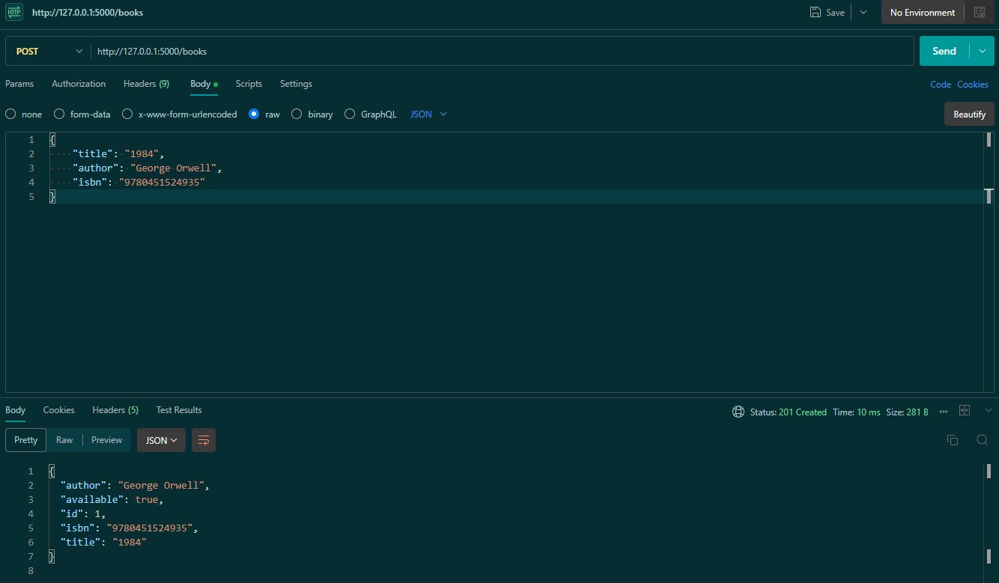
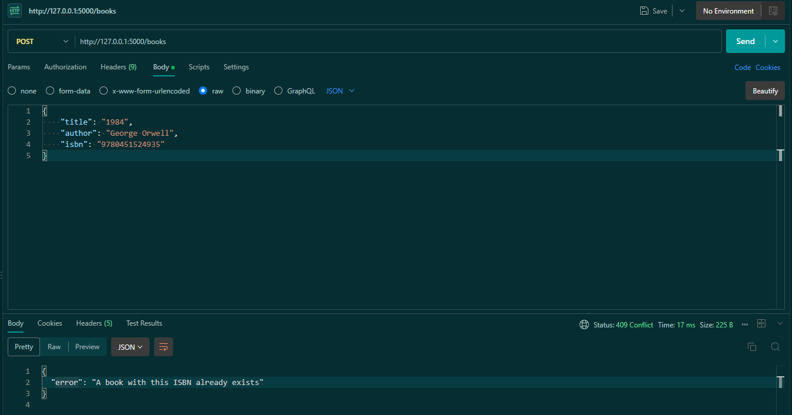
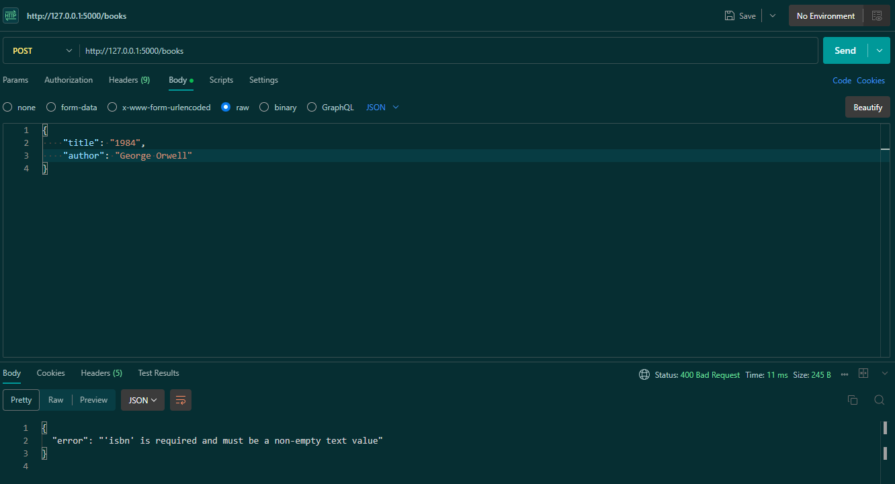
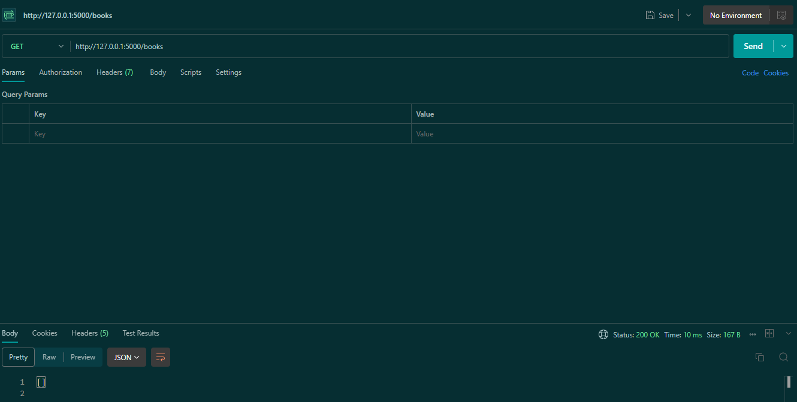
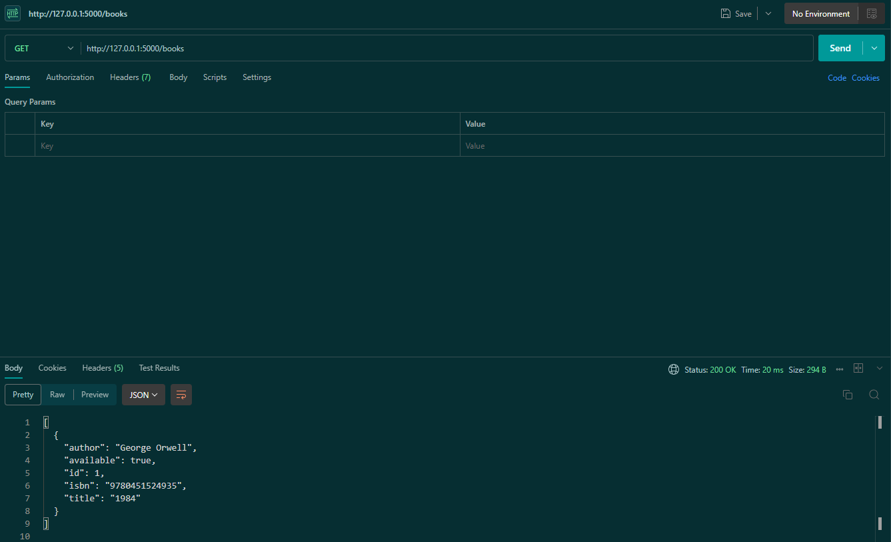
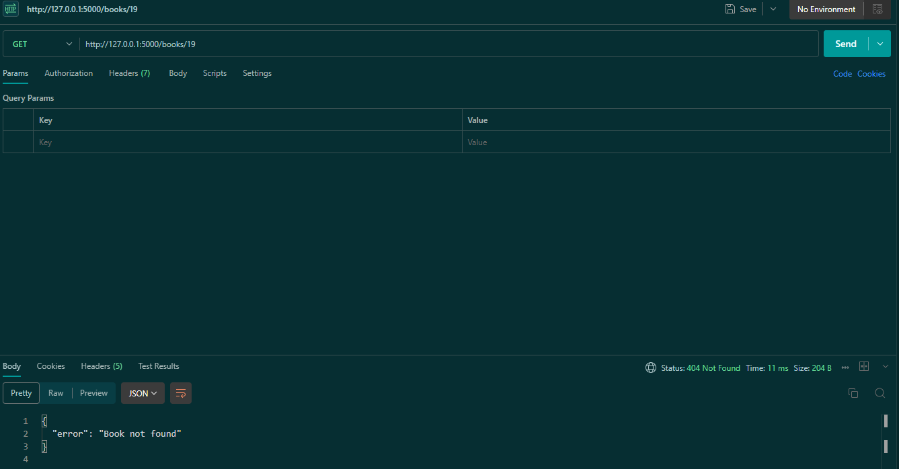
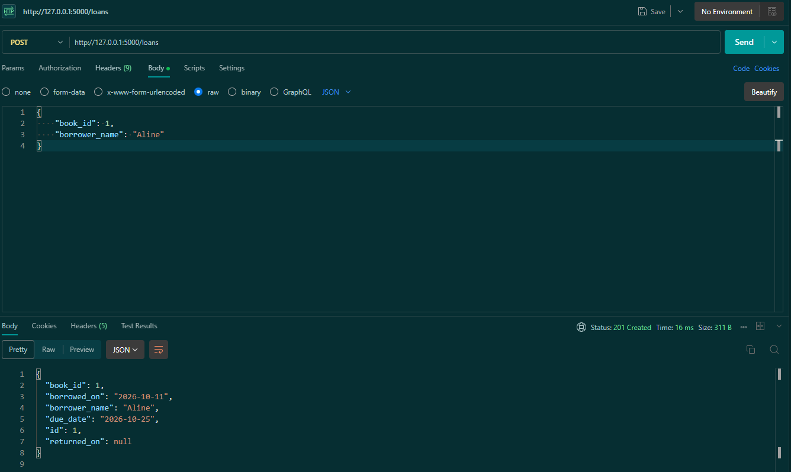
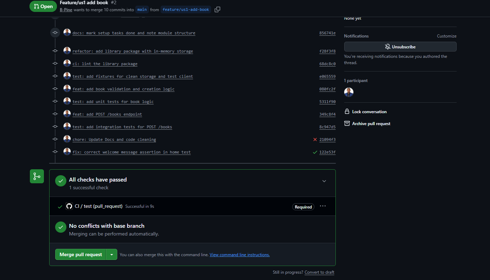
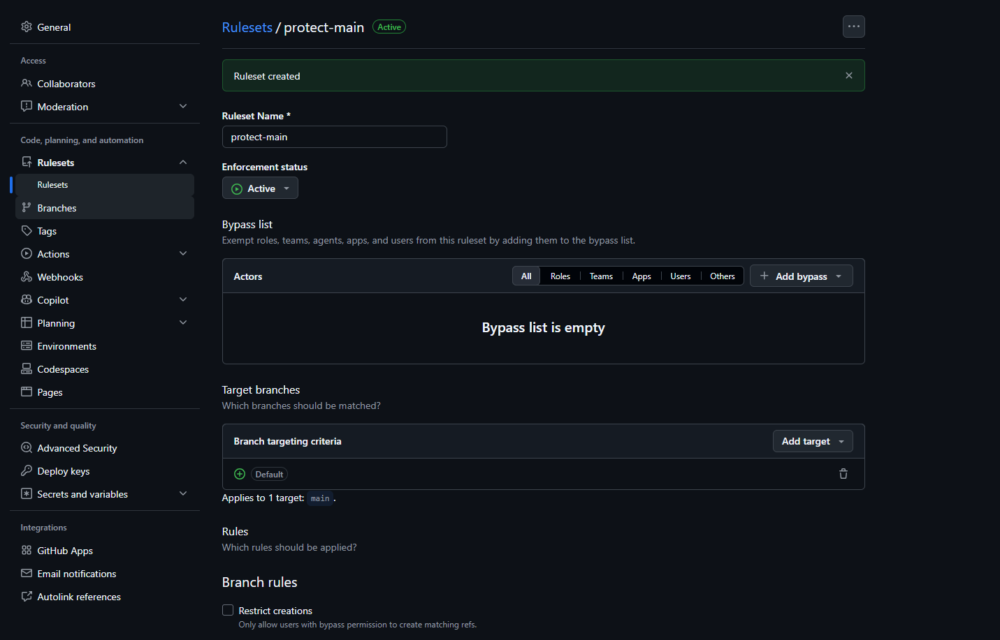
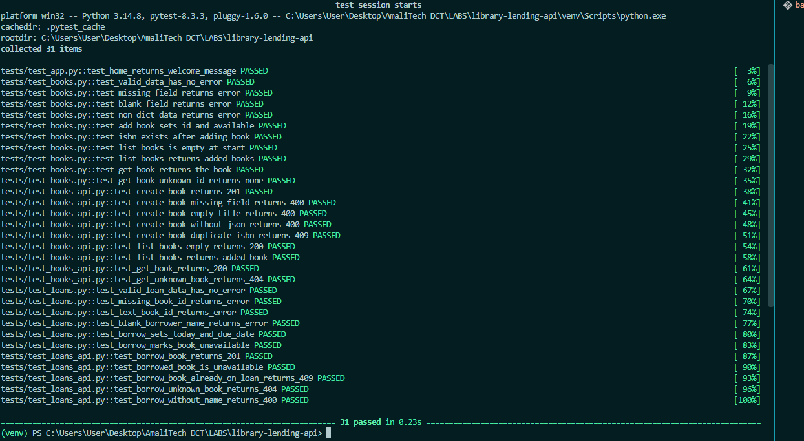

# Sprint 1 Review

**Sprint Goal:** A librarian can add books, see what is available, and lend a book out,
with every change automatically tested in CI.

**Goal met:** ✅ Yes

## Delivered Stories

| ID  | Story               | Points | Status | Pull Request |
|-----|---------------------|--------|--------|--------------|
| US1 | Add a book          | 2      | Done   | #2           |
| US2 | List and view books | 2      | Done   | #3           |
| US3 | Borrow a book       | 3      | Done   | #4           |

**Planned:** 7 points | **Completed:** 7 points | **Velocity:** 7

## Demo

### US1 – Add a book
Valid book created with `available: true` (201):

Duplicate ISBN rejected (409):

Missing field rejected (400):

### US2 – List and view books
Empty list when no books exist (200):

List after adding a book (200):

Unknown book (404):

### US3 – Borrow a book
Loan created with a due date 14 days from today (201):

## DevOps Evidence

**CI pipeline:** GitHub Actions runs flake8 and pytest on every Pull Request to `main` and
on every merge to `main`.

**Protected main branch:** a ruleset requires a Pull Request and a passing CI check before
anything can be merged.

**Tests:** 26 tests passing, covering every acceptance criterion of US1–US3. Unit tests check
the logic in `library/` directly; integration tests check the HTTP endpoints.

## Not Delivered
Nothing. All planned stories were completed.

## Backlog Changes
- **US3 refined:** while building US3, I found the backlog didn't say what happens when
  `book_id` or `borrower_name` is missing. I added a 400 acceptance criterion to the backlog
  and implemented it in the same sprint.
- **Observation for US6:** `GET /books/abc` returns Flask's default 404 page in HTML, not JSON
  like the rest of the API. This will be handled with the error-handling work in US6 (Sprint 2).
- US4 (Return a book), US5 (Overdue loans) and US6 (Health & logging) are ready for Sprint 2.