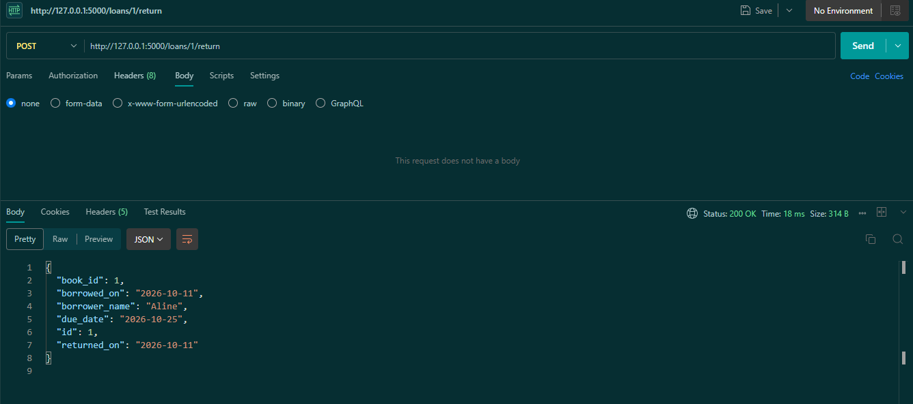
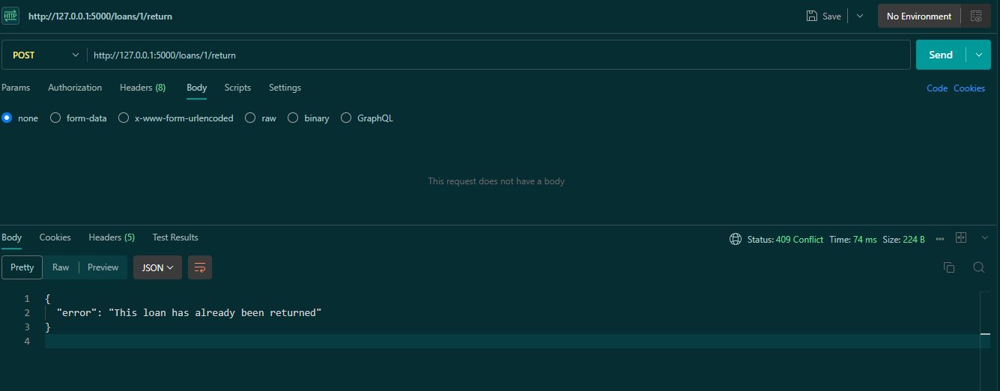
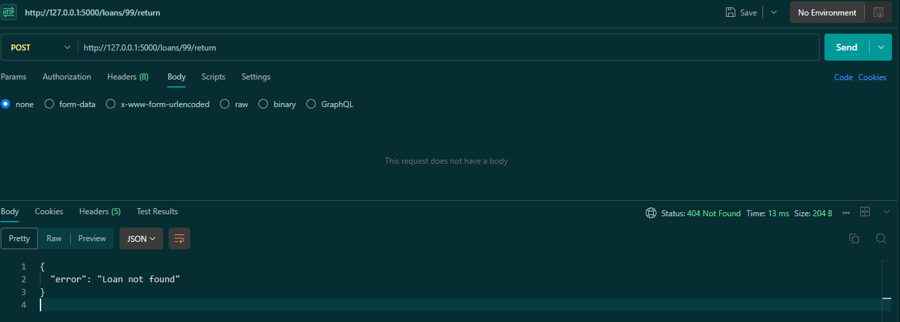
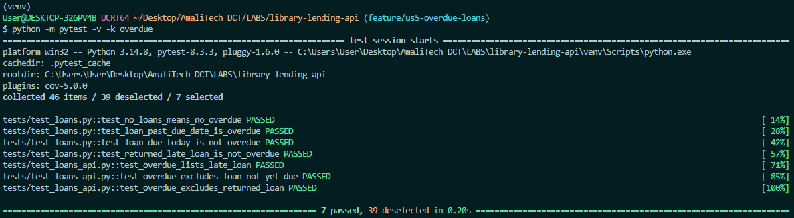
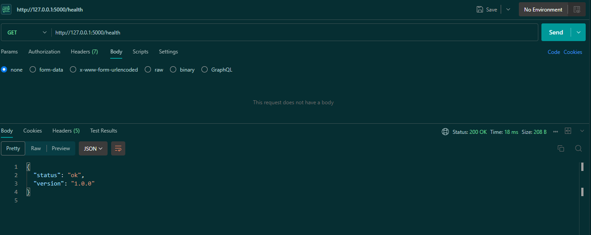
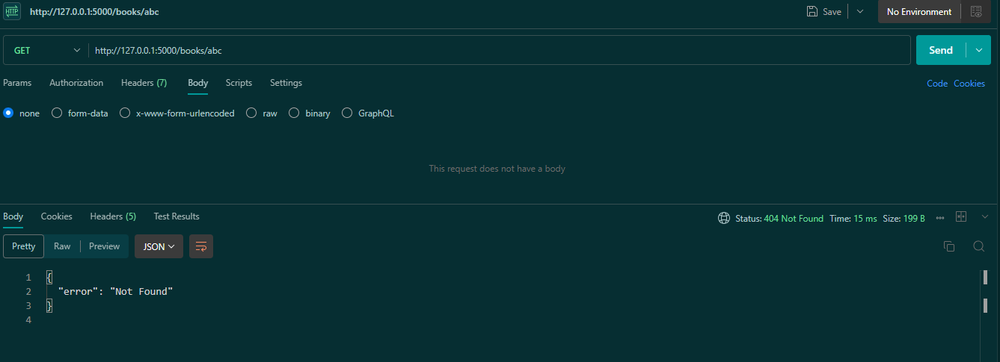
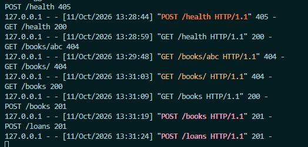
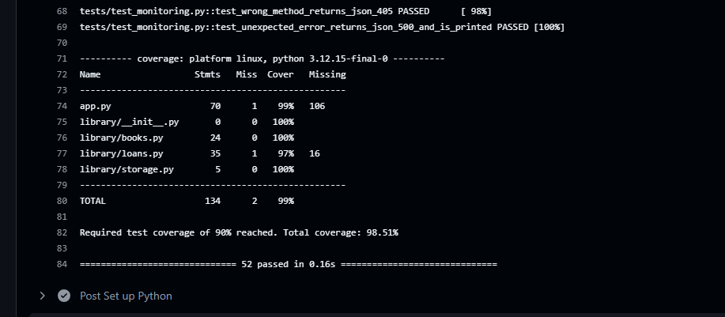
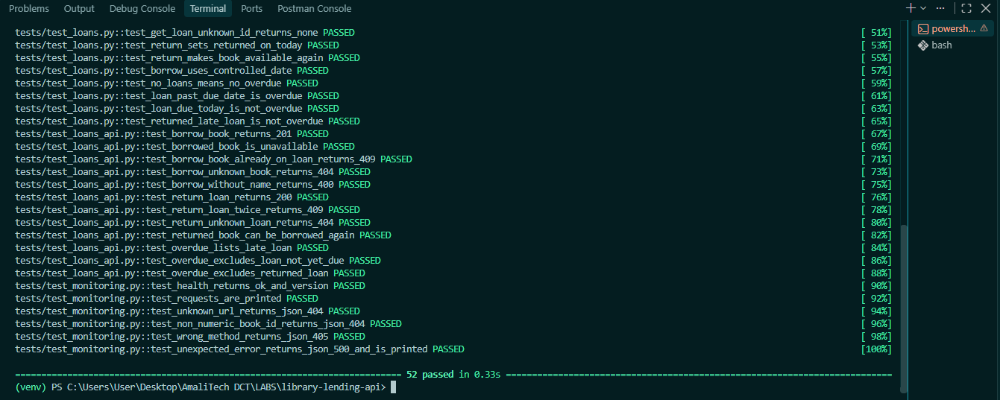
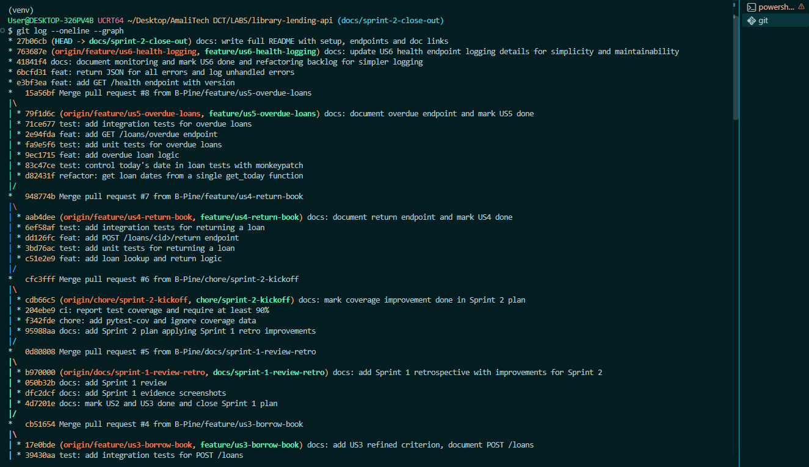

# Sprint 2 Review

**Sprint Goal:** A librarian can complete the lending cycle (return books and see overdue
loans), and the service can be monitored through a health endpoint, request logs and
consistent error responses.

**Goal met:** ✅ Yes

## Delivered Stories

| ID  | Story                       | Points | Status | Pull Request |
|-----|-----------------------------|--------|--------|--------------|
| US4 | Return a book               | 2      | Done   | #7           |
| US5 | See overdue loans           | 3      | Done   | #8           |
| US6 | Health endpoint and logging | 2      | Done   | #9           |

**Planned:** 7 points | **Completed:** 7 points | **Velocity:** 7 (same as Sprint 1)

## Demo

### US4 – Return a book
Loan returned, `returned_on` set (200):

Returning twice (409):

Unknown loan (404):

### US5 – See overdue loans
The overdue case cannot be shown manually without waiting 14 days, so it is demonstrated
through tests that control today's date (Retro Improvement 2):

### US6 – Health endpoint and logging
Health endpoint (200):

Unknown URLs now return JSON instead of HTML (Retro Improvement 4):

Every request printed to the console:

## DevOps Evidence

**Coverage in CI:** every pipeline run now reports test coverage and fails below 90%
(Retro Improvement 1). Current coverage: 98.51%.

**Tests:** 52 tests passing across unit and integration tests.

**Commit history:** small commits on feature branches, merged through Pull Requests.

## Not Delivered
Nothing. All planned stories were completed.

## Backlog Changes
- **US6 simplified:** logging was first designed with request duration and a logging library.
  It was reduced to console prints (method, path, status, and stack traces for errors), which
  meets the requirement for basic monitoring with simpler code. The acceptance criteria were
  updated to match.
- **US7 (Search) and US8 (Members)** remain in the backlog as lower-priority "Could" stories.